# AI Image-to-3D Studio

> An AI-powered platform turning an uploaded 2D image into a real, downloadable 3D asset via Vision-Language Model (VLM) analysis, AI geometry planning, and a deterministic Blender geometry engine.

---

## 🌟 Overview

**AI Image-to-3D Studio** bridges the gap between semantic AI reasoning and production-ready 3D geometry. Traditional VLMs can describe images but cannot directly produce valid, manifold 3D meshes. Image-to-3D Studio solves this by splitting the generation pipeline into distinct, specialized stages:

1. **Vision-Language Analysis:** Extracts semantic object classes, component breakdowns, spatial proportions, materials, and reference viewpoints from a single photograph.
2. **AI Geometry Planning:** Transforms visual observations into a strictly typed, validated `SceneSpec` schema detailing geometric primitives, hierarchical transforms, and material properties.
3. **Deterministic Geometry Engine:** A headless, sandboxed Blender LTS worker parses the validated `SceneSpec` and constructs non-fake, verified 3D meshes exported directly to industry-standard GLB format.

The platform embraces a **Universal Bring-Your-Own-Key (BYOK)** model—supporting leading AI providers (OpenAI, Groq, Inception Labs, Gemini, Anthropic) while keeping credentials envelope-encrypted at rest and never exposed to the client.

---

## 🔄 Generation Pipeline

```mermaid
flowchart LR
    A["📷 Image"] --> B["⚙️ Preprocessing"]
    B --> C["👁️ VLM Analysis"]
    C --> D["📋 Structured Object Description"]
    D --> E["🧠 AI Geometry Planning"]
    E --> F["✅ Validated SceneSpec"]
    F --> G["🔨 3D Geometry Construction (Blender LTS)"]
    G --> H["🔍 Mesh Validation"]
    H --> I["📦 GLB Export"]
    I --> J["💾 Storage (S3-compatible)"]
    J --> K["🌐 3D Viewer (Three.js/R3F)"]
    K --> L["⬇️ Download (.glb)"]
```



---

## 🏗️ Architecture Stack

| Layer | Technologies & Libraries | Rationale & Purpose |
|---|---|---|
| **Frontend** | **Next.js 15+ / React 19 / TypeScript (Strict)**<br>Tailwind CSS, shadcn/ui, Radix UI<br>React Three Fiber (R3F), Three.js, @react-three/drei<br>Zustand, TanStack Query, Zod | Modern, accessible, high-performance web studio shell with declarative 3D canvas viewport, real-time client state management, and strict schema validation. |
| **Backend & Services** | **Python 3.11+ / FastAPI / Pydantic v2**<br>PostgreSQL & Drizzle ORM<br>Redis & BullMQ<br>S3-Compatible Object Storage (MinIO / Cloudflare R2 / AWS S3)<br>Docker & Docker Compose | High-throughput asynchronous orchestration API, resilient background queues for compute-intensive tasks, durable relational persistence, and secure pre-signed object URLs. |
| **3D Engine** | **Blender 4.x LTS (Headless / Python API `bpy`)**<br>glTF 2.0 / Binary glTF (`.glb`) | Deterministic procedural geometry construction, audited primitive builders, boolean/modifier pipelines, PBR material assignments, and strict mesh validation. |
| **AI & Providers** | **Universal BYOK (Bring Your Own Key)**<br>OpenAI, Groq, Inception Labs (Mercury), Google Gemini, Anthropic | Modular provider registry routing image analysis to vision-capable endpoints and geometry planning to high-reasoning code/text models with envelope encryption at rest. |

---

## 📁 Repository Layout

```text
image-to-3d-studio/
├── apps/
│   └── web/                   # Next.js web application, UI routes & studio viewer
├── packages/
│   ├── contracts/             # SceneSpec schemas, API DTOs, and provider contracts
│   ├── db/                    # PostgreSQL schema, Drizzle ORM migrations & queries
│   ├── auth/                  # Authentication, session handling & ownership checks
│   ├── providers/             # Universal BYOK registry & provider adapters
│   ├── ai-pipeline/           # VLM analysis & SceneSpec planning prompts and normalizers
│   ├── storage/               # S3-compatible storage client & signed URL handlers
│   └── viewer/                # React Three Fiber 3D viewport & camera controls
├── services/
│   ├── jobs/                  # Asynchronous queue worker & orchestration lifecycle
│   └── geometry-worker/       # Headless Blender LTS procedural geometry service
├── docs/
│   ├── architecture.md        # Technical architecture, versions & boundary specifications
│   └── image_to_3d_core_product_prd.md # Full product requirements document (PRD)
├── infra/
│   ├── docker-compose.yml     # Local orchestration (PostgreSQL, Redis, MinIO, workers)
│   └── Dockerfile.geometry    # Containerized headless Blender LTS worker
├── tests/
│   ├── fixtures/              # Deterministic test images, SceneSpec fixtures & golden GLBs
│   ├── unit/                  # Schema, primitive builder & crypto unit tests
│   ├── integration/           # Queue, API, and storage integration tests
│   └── e2e/                   # End-to-end browser & generation pipeline tests
├── .gitignore
└── README.md
```

---

## 🎯 Milestone Roadmap

- [ ] **M1: Verified Geometry Engine**
  - SceneSpec v1 schema validation with Zod / Pydantic
  - Headless Blender LTS procedural builder executing audited primitive operations
  - Automated GLB re-import mesh verification (>0 non-degenerate triangles, valid bounds)
- [ ] **M2: Accounts, Projects & Private Storage**
  - Secure authentication and user-scoped data boundaries
  - Image upload with MIME sniffing, size constraints, and private S3 storage
  - Persistent project library surviving container/app restarts
- [ ] **M3: Universal BYOK Provider Registry**
  - Envelope-encrypted credential vault (AES-256-GCM) with master secret separation
  - Capability-aware model registry (vision vs. planner vs. multi-modal gating)
  - Safe connectivity testing without echoing plaintext credentials
- [ ] **M4: Full End-to-End AI Generation Pipeline**
  - Asynchronous BullMQ worker orchestration: Image Analysis → Scene Planning → Geometry Construction → Validation
  - Integration with OpenAI, Groq, Inception Labs, Gemini, Anthropic
  - Deterministic fallbacks, idempotency tokens, and robust error classification
- [ ] **M5: Interactive Creator Studio & Viewer**
  - React Three Fiber interactive viewport: orbit, zoom, pan, wireframe, grid, lighting presets
  - Model inspection: triangle count, dimensions, part hierarchy
  - Authenticated single-click `.glb` asset download
- [ ] **M6: Production Hardening & Operations**
  - Rate limiting, timeout guarantees, sandboxed geometry worker limits (CPU/memory/no-egress)
  - Automated CI test suites, health checks, and Docker Compose deployment manifests
  - Comprehensive documentation and operational runbooks

---

## 🔒 Security & Privacy

- **Zero Plaintext Secrets:** User API keys are encrypted at rest using AES-256-GCM and never returned via API responses or recorded in logs.
- **Sandboxed Execution:** Geometry construction runs in an isolated container without outbound network access. No arbitrary AI code execution.
- **Private by Default:** Uploaded images and generated 3D assets are stored in private object storage accessible only via authenticated, short-lived signed URLs.

---

## 📄 License

Apache-2.0 / MIT
