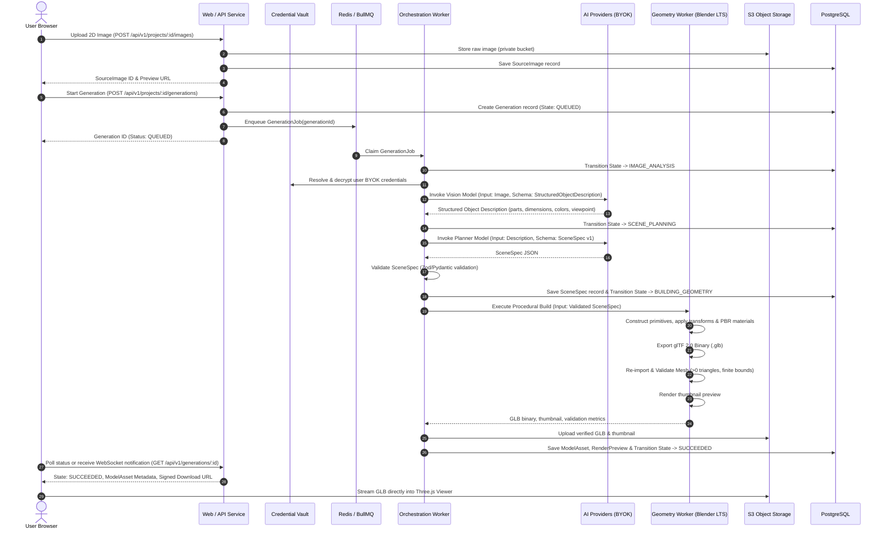

# Architecture Specification: AI Image-to-3D Studio

**Status:** Approved Baseline  
**Version:** 1.0.0  
**Date:** November 2026  

---

## 1. Executive Summary & Core Paradigm

**AI Image-to-3D Studio** converts single-view 2D images into interactive, verifiable 3D meshes (GLB format).

A fundamental architectural tenet of this system is **non-faking of 3D geometry**:
- Vision-Language Models (VLMs) and Large Language Models (LLMs) **do not directly emit 3D binary geometry**. They perform semantic visual analysis and spatial/hierarchical planning.
- Geometry generation is **deterministic and procedural**, executed by an isolated, audited **Blender LTS** worker.
- The interface between the AI reasoning layer and the 3D execution engine is a strictly versioned and validated contract: the **SceneSpec (v1)** schema.
- Arbitrary AI-generated executable code (such as raw Python scripts executed directly in Blender) is **strictly disallowed** to prevent remote code execution (RCE) and system compromise.

---

## 2. Technology Stack & Verified Versions

| Component | Technology | Version | Rationale & Selection Criteria |
|---|---|---|---|
| **Web Framework** | Next.js (App Router) | `15.x` | Industry standard for React server components, secure server-side session handling, edge routing, and streaming responses. |
| **UI Library** | React | `19.x` | Modern declarative UI engine supporting concurrent rendering and optimized client components. |
| **Language** | TypeScript | `5.6+` | Strict mode enabled across all apps and packages; guarantees compile-time type safety across data boundaries. |
| **Styling & UI Components** | Tailwind CSS / shadcn/ui (Radix) | `v4 / latest` | Accessible, headless primitives styled with utility-first CSS; dark/light mode and low-cognitive-load industrial UI. |
| **3D Rendering** | Three.js / React Three Fiber / Drei | `Three r170+ / R3F v9+` | Industry standard WebGL/WebGPU 3D canvas for interactive orbit, zoom, pan, lighting, and wireframe inspection. |
| **State Management** | Zustand & TanStack Query | `v5` | Lightweight client-side studio state (viewer toggles) coupled with robust asynchronous cache and job polling. |
| **Schema Validation** | Zod (TS) & Pydantic (Python) | `Zod 3.x / Pydantic 2.x` | Dual-sided strict data contract enforcement for API DTOs, SceneSpec JSON schemas, and configuration. |
| **Backend & Services** | Python / FastAPI | `Python 3.11+ / FastAPI 0.115+` | High-throughput asynchronous service framework ideal for compute, geometry orchestration, and data transformation. |
| **Relational Database** | PostgreSQL | `16+` | ACID-compliant relational storage for users, encrypted credentials, projects, generations, and asset metadata. |
| **Database ORM** | Drizzle ORM | `latest` | Type-safe SQL schema definition, zero-overhead queries, and deterministic migration tooling. |
| **Queue & Cache** | Redis & BullMQ | `Redis 7.x / BullMQ 5.x` | Distributed queue management for asynchronous generation workflows with heartbeat leasing, retries, and failure backoff. |
| **Object Storage** | S3-Compatible API (MinIO / R2 / S3) | Standard S3 API | Secure, scalable storage for raw uploaded images, exported GLB assets, and rendered preview thumbnails via short-lived signed URLs. |
| **3D Geometry Engine** | Blender LTS | `4.2 LTS` | Audited headless Python environment (`bpy`) for procedural mesh building, UV/PBR material application, and glTF 2.0 export. |
| **Containerization** | Docker & Docker Compose | `Engine 27+ / Compose v2` | Hermetic local development and production container definitions with strict resource constraints and network isolation. |

---

## 3. End-to-End Generation Pipeline

The generation lifecycle transitions through explicit, immutable, asynchronous stages:



---

## 4. Module & Dependency Boundaries

To support clean architecture and multi-agent development, code is partitioned into disjoint workspaces:

```
┌────────────────────────────────────────────────────────────────────────┐
│                               APPS                                     │
│  apps/web (Next.js 15, React 19, Tailwind, shadcn/ui)                 │
└──────────────────┬───────────────────────────────┬─────────────────────┘
                   │                               │
┌──────────────────▼──────────────┐ ┌──────────────▼─────────────────────┐
│            PACKAGES             │ │              PACKAGES              │
│  packages/contracts (Schemas)   │ │  packages/viewer (Three.js / R3F)  │
│  packages/db (Drizzle / Postgres│ │  packages/storage (S3 client)      │
│  packages/auth (Session/Auth)   │ │  packages/providers (BYOK SDKs)   │
│  packages/ai-pipeline (Prompts) │ │                                    │
└──────────────────┬──────────────┘ └──────────────┬─────────────────────┘
                   │                               │
┌──────────────────▼───────────────────────────────▼─────────────────────┐
│                              SERVICES                                  │
│  services/jobs (BullMQ Queue & Pipeline Orchestrator)                  │
│  services/geometry-worker (Headless Blender 4.2 LTS Mesh Builder)       │
└────────────────────────────────────────────────────────────────────────┘
```

### Module Responsibilities:
1. **`packages/contracts`**: The single source of truth for all schemas. Contains the `SceneSpec` v1 Zod/Pydantic specifications, API request/response DTOs, and error code definitions. Zero internal dependencies.
2. **`packages/providers`**: Implements the Universal BYOK registry. Gated by model capabilities (`vision`, `text`, `structuredOutput`, `codeGeneration`). Handles envelope encryption/decryption of provider secrets.
3. **`packages/ai-pipeline`**: Prompt engineering and structured output normalizers for VLMs and planner LLMs.
4. **`services/geometry-worker`**: Python-based headless Blender service. Consumes `SceneSpec` JSON, invokes verified `bpy` mesh generation functions, audits resulting geometry, and yields verified `.glb` files. Runs sandboxed with **no outbound internet access**.
5. **`services/jobs`**: BullMQ job consumer coordinating AI provider calls, error recovery, retries, and persistence updates.
6. **`apps/web`**: Authenticated web application, project management, BYOK settings interface, and React Three Fiber 3D studio viewer.

---

## 5. Data Contracts & SceneSpec Specification

The `SceneSpec` v1 defines the bounded geometric representation:

```json
{
  "$schema": "https://image-to-3d-studio.internal/schemas/scenespec-v1.json",
  "schemaVersion": "1.0",
  "objectName": "simple_wooden_stool",
  "coordinateSystem": "Z_UP",
  "units": "relative",
  "referenceView": {
    "azimuthDeg": 35.0,
    "elevationDeg": 15.0
  },
  "parts": [
    {
      "id": "seat",
      "type": "cylinder",
      "size": [1.5, 1.5, 0.16],
      "position": [0.0, 0.0, 1.1],
      "rotationDeg": [0.0, 0.0, 0.0],
      "materialId": "wood_oak"
    },
    {
      "id": "leg_1",
      "type": "cylinder",
      "size": [0.12, 0.12, 1.1],
      "position": [-0.5, -0.5, 0.55],
      "rotationDeg": [0.0, 0.0, 0.0],
      "materialId": "wood_oak"
    }
  ],
  "materials": [
    {
      "id": "wood_oak",
      "baseColor": "#8F684A",
      "roughness": 0.7,
      "metallic": 0.0
    }
  ],
  "uncertaintyNotes": [
    "Rear legs and underside estimated from single-view photograph."
  ]
}
```

### Supported Primitives in P0:
- `box`
- `cylinder`
- `sphere`
- `cone`
- `capsule`
- `torus`
- `lathe` (bounded rotational profile)
- `extrudedPolygon` (bounded 2D vertices)

### Geometry Invariants:
- Maximum part count: 64
- Maximum triangle budget: 250,000
- Maximum dimensions: bounded within `[-10.0, 10.0]` relative coordinate space
- Strict prohibition of code injection: No Python strings, shell commands, or arbitrary file paths permitted in SceneSpec.

---

## 6. Security & Credential Isolation

1. **Envelope Encryption for BYOK:**
   - Provider API keys are encrypted using AES-256-GCM.
   - Master key is supplied via environment (`CREDENTIAL_ENCRYPTION_MASTER_KEY`) and never stored in the database.
   - Ciphertext, initialization vector (nonce), authentication tag, and key version are stored in the database.
   - API endpoints never return plaintext keys or nonces; only non-sensitive masked fingerprints (e.g., `••••1234`) are displayed.
2. **SSRF and Network Protection:**
   - Custom provider URLs (P1) are strictly restricted via IP/DNS allowlists (preventing access to internal cloud metadata `169.254.169.254`, localhost, or private subnets).
3. **Geometry Sandbox:**
   - Headless Blender worker executes with dropped privileges (non-root), CPU/memory quotas, execution time limits (max 60 seconds), and disabled outbound networking.
4. **Asset Validation:**
   - Exported GLB files are inspected for malicious external URI references, memory overflow exploits, and valid glTF 2.0 headers before being marked `SUCCEEDED`.
