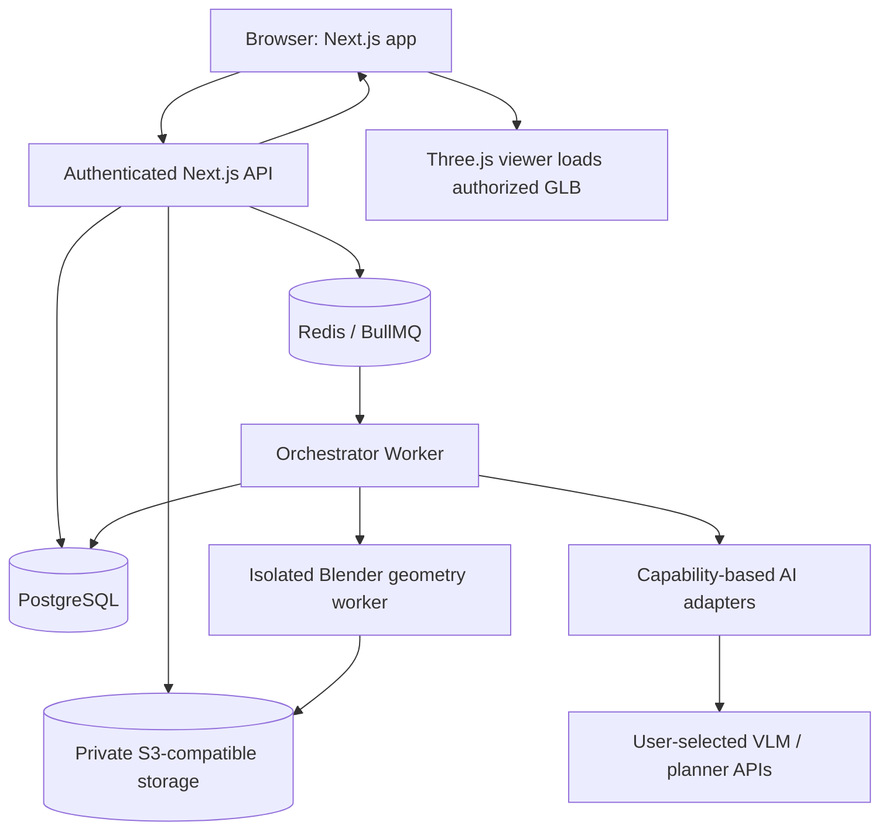

# IMAGE → 3D STUDIO
## Production-oriented product requirements document (PRD) and Marshell execution specification
**Version:** 1.0  
**Date:** 22 November 2026  
**Status:** Build specification / not an implementation  
**Priority:** Working core product first, polish second  
**Working name:** Image → 3D Studio (renameable; do not block implementation on branding)

---

## 0. Executive decision summary

Build a real web application where an authenticated user provides a photograph of a single object, connects their own AI provider keys (BYOK), chooses a **compatible vision model** and a **compatible geometry-planning model**, and obtains an actual 3D mesh generated by an independently operated geometry engine. Show it in an interactive browser viewer and offer a verified `.glb` download. Persist the job, model, original image, status, and version.

**The critical product distinction:** a VLM is not, by itself, a mesh generator. A vision model interprets the image; a planning model describes an approximate 3D scene in a constrained schema; a deterministic procedural geometry engine and/or isolated Blender worker builds the real mesh. Image-to-3D specialist providers can be added as an alternative pipeline. Do **not** substitute a static render, generic stock model, renamed file, fake progress indicator, or hardcoded output.

**First working milestone / core launch definition:** a user connects valid compatible credentials, uploads an image of a simple object, starts a VLM-guided procedural generation job, receives a mesh that approximates the visible object, rotates it in a Three.js viewer, downloads a valid GLB, signs out and in, and finds the same saved model in their library. The job survives browser refresh and worker restarts. Tests run and failures are surfaced honestly.

**Initial content domain:** simple individual physical objects: stools, chairs, lamps, mugs, boxes, tables, shelving, simple household objects, low-poly props. Complex organic or intricately textured objects are explicitly lower-confidence. Single-photo reconstruction cannot know obscured surfaces or real-world scale without assumptions.

**Core technology recommendation:** Next.js + TypeScript UI/API, PostgreSQL/Prisma, S3-compatible object storage, Redis/BullMQ job queue, a separate Python/Blender geometry worker, Three.js/React Three Fiber, Zod for payload validation, and a capability-based AI provider registry. All provider secrets remain server side.

---

## 1. Vision and problem statement

### Vision
Make 3D creation approachable to people who have only a photograph, without requiring them to model an asset manually or learn Blender. Let users use their own AI API accounts while the platform owns the 3D geometry and user-experience pipeline.

### Problem
Existing workflows often require 3D modeling expertise or binding users to a specific 3D generation service. General-purpose language and vision models can describe geometry but do not normally output complete meshes by themselves. The product bridges this gap using vision analysis, structured scene planning, deterministic geometry construction, visual inspection, and a real asset pipeline.

### Primary value proposition
*One photo → understandable AI analysis → editable approximate geometry → rotatable downloadable 3D asset,* while allowing choice of compatible BYOK models.

### Target users
- Indie developers needing low-poly prototype props.
- Designers visualizing simple products.
- Students and educators exploring 3D geometry.
- Makers previewing shapes (not promised manufacturing-grade).
- Small businesses creating preliminary 3D catalog assets.

### Explicit non-promises
- Not photogrammetry or true measurement from a single image.
- Not photorealistic reconstruction of arbitrary objects.
- Not guaranteed watertight, print-ready, or engineering/CAD-accurate geometry.
- Not guaranteed support for every provider/model just because that provider offers an API key.
- Not automatic access to proprietary 3D model weights through a generic chat API.

---

## 2. Product principles and must-not-fake rules

1. **Core before surface:** implement a complete end-to-end successful path before decorative landing pages, pricing, or marketing.
2. **Real output:** generated `.glb` contains valid mesh geometry; user can orbit it and download it.
3. **Honest capability routing:** analyze images with a vision-capable endpoint; plan geometry with a capable language/coding model; specialists only when explicitly integrated and verified.
4. **Portable assets:** users retain access to files in formats we actually generate.
5. **Secure BYOK:** user-supplied API keys encrypted at rest, never returned in plaintext.
6. **Durability:** generation is asynchronous, retriable within policy, and persisted.
7. **Observable correctness:** job history and machine-verifiable output checks.
8. **Limited complexity initially:** targeted object classes and bounded geometry complexity.
9. **Accessibility:** keyboard controls, clear error states, responsive editor and reduced-motion behavior.
10. **No hidden fallback:** mock data only in explicitly marked development/test mode.

---

## 3. Scope — release tiers

### P0 — absolutely required for core working product
- Email/password or trustworthy hosted authentication; account creation/login/logout.
- User dashboard / model library.
- BYOK credential creation, validation/test, masking, selection, revocation, and deletion.
- Provider registry with at least one genuinely verified vision path and one genuinely verified planner path. These may be the same provider/model if it really supports both.
- Image upload, type/size checks, preview, private object storage.
- Single-image analysis into structured scene description.
- Constrained procedural geometry representation and validation.
- Actual mesh generation by controlled geometry engine (not arbitrary LLM code execution).
- Asynchronous queue and status API (queued/running/succeeded/failed/canceled when possible).
- `.glb` export, asset inspection/validation, private download.
- Interactive 3D viewer: orbit, zoom, pan, reset framing, ground/grid, material shading and wireframe toggle.
- Save source, generated model, metadata and jobs to database.
- Failure handling, app logs, request IDs, basic retry and timeout.
- Automated tests and deployment docs.

### P1 — build immediately after P0 is proven
- VLM screenshot comparison / render-refine loop with 1–3 bounded iterations.
- Scene part inspector, move/rotate/scale and material color edits; preserve editable scene specification.
- Version history, regenerate from same source, download `.blend` and valid OBJ/STL conversions.
- Additional provider adapters such as Inception, Groq, OpenAI, Google, Anthropic, Tripo, Meshy where capability permits.
- Optional multi-image input and explicit camera-angle handling.
- Model optimization/decimation, texture generation where available.
- Cancel queues where safe; progress details; user-controlled generation budgets.

### P2 — not a blocker for core
- Collaborative workspaces, public sharing, marketplace, subscriptions, credits, project teams, complex 3D sculpting, rigging, animation, CAD dimensions, mobile native apps, high-end organic mesh reconstruction, user-run compute endpoints, unlimited provider compatibility.

### Excluded from P0
Landing-page spectacle, payment gateway, enterprise tenancy, model training, proprietary image-to-3D neural network training, GPU-cluster management, every imaginable export format, an automatic promise of precise hidden surfaces.

---

## 4. Primary end-to-end user journey

### Journey A: first-time happy path
1. User opens app and creates an account.
2. App opens onboarding with short explanation: `A VLM interprets your photo; a geometry engine constructs the mesh. Results are approximate.`
3. User opens **Settings → AI Providers**, selects a known provider and pastes an API key over HTTPS.
4. Backend encrypts the credential, creates a user-scoped record, and does not echo plaintext. Optional connectivity check uses a safe read/list/test request if available; otherwise label as `Not tested` until a real inference succeeds.
5. User selects *Image Understanding* and *Geometry Planning* models using only supported capabilities. Provide an actionable warning if the selected model cannot consume images.
6. User creates a project and uploads one clear photo of a simple object.
7. Client previews image and a concise quality tip; backend validates/normalizes and stores private original.
8. User clicks **Generate 3D** and sees an estimated provider cost note if a grounded estimate exists; otherwise `Provider may charge usage fees`.
9. Backend creates a project generation job with immutable input snapshot, model IDs, credential references, and idempotency key. Queue worker claims it.
10. Vision adapter inspects input image. The service returns structured description: object class, visible parts, relative dimensions, materials/colors, confidence/uncertainty, reference viewpoint, and unknown hidden features.
11. Planner model generates constrained SceneSpec JSON with a supported list of primitives, part transforms and material assignments.
12. Validate SceneSpec against JSON Schema/Zod/Pydantic, reject excessive values, recursively re-prompt once for correct structure if needed.
13. Geometry worker converts scene parts to actual geometry using safe deterministic Blender/Python functions. Save editable SceneSpec plus `.blend` if built with Blender. **Do not execute raw, arbitrary AI-generated scripts**.
14. Construct a GLB; run asset checks; create preview thumbnail. Persist output to private object storage.
15. Mark job `succeeded` only after GLB re-import and geometry validation pass.
16. Web app reflects status and loads the asset through a time-limited, authorized URL.
17. User rotates, zooms and inspects mesh; downloads GLB.
18. On reload/login, model appears in **My Models**, with original reference, generation settings, status and download action.

### Journey B: API error
- Missing key → disabled generation and CTA to connect provider.
- Wrong key → `Authentication rejected by provider` with clear reconnection action, not a generic 500.
- Provider model lacks vision → block request before spending money.
- Rate limit/quota → preserve image and job record, mark `blocked` or `failed`, allow user to retry after appropriate backoff, without accidental duplicate charge.
- Provider response malformed → bounded repair attempt followed by actionable failure.

### Journey C: worker or storage error
- Worker crash → lease expires; stalled job recovered safely; risk of duplicate charge logged and mitigated.
- Export fails → show failure; do not expose incomplete output.
- Viewer cannot load → display helpful error and offer download only if asset actually validated.
- Object deletion and credential deletion must respect ownership.

---

## 5. UX and interface product requirements

### Route map
- `/` = redirect to workspace or login; public marketing can be tiny.
- `/login`, `/signup` = auth.
- `/app` = recent projects, new generation CTA, usage overview.
- `/app/new` = single-image upload and prompt/configuration wizard.
- `/app/projects/[projectId]` = project dashboard.
- `/app/models/[modelId]` = real 3D studio viewer, versions and export.
- `/app/jobs/[jobId]` = generation status / error / logs overview.
- `/app/settings/providers` = universal BYOK manager.
- `/app/settings/account` = account and data controls.

### Design
- Product-first industrial/creative application, clean dark and light modes.
- App shell: thin left nav (Projects, Models, Generate, Providers, Settings); top bar (project name, save status, user menu).
- Generation page: left reference image + settings; middle prominent viewport/empty state; right contextual inspector only when model exists.
- Avoid gratuitous gradients, glowing orb metaphors, animation-heavy landing pages and nonfunctional controls.
- Empty states describe meaningful next action; do not present placeholder 3D models as generated results.
- Responsive: on narrow screens stack reference/model controls; touch gestures for 3D.
- Progress stages: `Uploading → Analyzing image → Planning geometry → Building mesh → Validating → Ready`. Never fake percent; use stage and indeterminate spinner when unknown.
- Keyboard tab order, visible focus, descriptive labels, accessible contrast, respects reduced motion.

### Main controls
- Upload / replace image.
- Select vision provider/model and planner provider/model.
- Optional user text: `This is a wooden stool; keep the seat rounded`.
- Geometry detail: `simple`, `standard` (not a promise of polygon count until supported).
- Generate; retry; create new version.
- Viewer: orbit, zoom, pan, reset view, grid toggle, wireframe, light preset.
- Inspect: object names, triangle/vertex counts, bounds, file size when known.
- Export: GLB P0; OBJ/STL/BLEND P1 if actual converters work.

---

## 6. AI/provider design and BYOK

### The three distinct roles
**Vision:** reads uploaded image, infers likely object components and camera perspective.  
**Planner:** maps analysis to SceneSpec geometry and materials.  
**3D executor:** deterministic geometry library/Blender worker constructs mesh. **This last stage is our platform code, not a chat API.**

### Provider support policy
- OpenAI: potentially vision and planning through compatible model endpoints; do not assume all models support images.
- Groq: vision/planning only for models with corresponding capabilities.
- Inception Mercury: geometry planning using an API endpoint with confirmed language/coding capabilities; **vision only if verified for the exact selected model and API version**. If Mercury is text-only, pair with a separate vision provider.
- Google/Anthropic: adapters only after API capability/schema verified.
- Tripo/Meshy: optional specialist image-to-mesh mode (P1), not required by core VLM-first path.
- Custom OpenAI-compatible: allow supported trusted HTTPS endpoints only, with controlled network policy and explicit capability declarations; not all compatibility layers provide vision or structured output.
- Allow configuring provider endpoints only through hardened allowlist/admin policy in P0; user-supplied arbitrary URLs are P1 after SSRF protection.

### Provider registry contract
Each provider exposes:
- `providerId, displayName, officialDocumentationUrl, credentialType`
- `capabilities: vision, text, structuredOutput, codeGeneration, imageTo3D` per **model**, not just provider
- `listModels(credential)` or curated verified model list; fallback to manual ID with explicit `Unverified` status
- `testCredential(credential)` when safe/possible; note it may be billable/unsupported
- `invokeVision(request): ImageAnalysis`
- `invokePlanner(request): SceneSpec`
- `submitImageTo3D(request)` / `pollImageTo3D(task)` only for verified specialist implementations
- `normalizeError(error): {code,retryable,userMessage}`
- metadata: input limits, supported file types, max tokens, endpoint/policy restrictions.

### BYOK UX
- List providers and capability chips.
- Add key via password-type field; submit once; never show saved original value.
- Key nicknames: `My Groq`, `Personal OpenAI`, `Mercury Workspace`.
- Connectivity status: Verified, Invalid, Untested, Temporarily unavailable.
- Set defaults independently for image analysis and geometry planning.
- Multiple keys per provider, account-scoped.
- Explicit delete and replace actions.
- Present provider usage caveat; charge goes to user's provider account, not necessarily zero cost.
- Show usage only if a provider officially exposes it; otherwise show this app's request counts, clearly labeled.

### Credential vault design
- Server-side envelope-encrypted secrets with AEAD (e.g. AES-256-GCM), a separately stored master key managed through secret manager.
- Nonces unique per ciphertext; record encryption key version for rotation.
- Database stores ciphertext, tag, nonsecret last-four-style mask if safe, provider, owner, created and verified times.
- Secrets never returned from API, logged, serialized to browser, included in queue messages, or placed in URLs.
- Worker resolves a `credentialId` under validated user/job ownership.
- Revoke and delete prevent future use; in-flight jobs have defined behavior.
- If master key missing, fail closed; never fall back to plaintext.
- Avoid exposing custom provider credentials to user-controlled endpoints; prevent SSRF, DNS rebinding and redirects to private addresses.

---

## 7. Geometry-generation engine — engineering heart of the product

### Why this exists
VLM output is semantic; a real 3D asset needs vertices, faces, normals, UVs/materials, hierarchy and serialized geometry. This engine bridges the gap.

### P0 strategy: constrained scene specification
Have planning model output **validated JSON**, not arbitrary Python code. It describes a scene of safe parts and relations; deterministic code creates the mesh. Example:

```json
{
  "schemaVersion": "1.0",
  "objectName": "simple_stool",
  "coordinateSystem": "Z_UP",
  "units": "relative",
  "referenceView": {"azimuthDeg": 35, "elevationDeg": 15},
  "parts": [
    {"id":"seat","type":"cylinder","size":[1.5,1.5,0.16],"position":[0,0,1.1],"rotationDeg":[0,0,0],"materialId":"wood"},
    {"id":"leg_1","type":"box","size":[0.13,0.13,1.05],"position":[-0.55,-0.55,0.52],"rotationDeg":[0,0,0],"materialId":"wood"}
  ],
  "materials": [{"id":"wood","baseColor":"#8F684A","roughness":0.75,"metallic":0}],
  "uncertaintyNotes": ["Rear leg positions are estimated from a single view."]
}
```

**Note:** four legs, orientation, and actual pose must be generated from the particular input; this sample is illustrative, not a universal stool template.

### Supported primitives P0
`box`, `cylinder`, `sphere`, `cone`, `capsule`, `lathe` from bounded profile, `extrudedPolygon` from bounded valid 2D points, `torus` if renderer supports. Flat-plane materials are permitted, but should not be used to fake a complete volumetric mesh. Compose and transform parts; group by semantic IDs.

### SceneSpec invariants
- Schema versioned, full strict validation.
- Fixed max parts, vertices, triangle budget, bounds, numeric magnitude, material slots, texture input size, profile points and execution time.
- No arbitrary URLs, file paths, imports, expressions, code strings, shader fragments, system commands, Python/JS evaluation or custom binaries in specs.
- Coordinates and units normalized; up-axis explicit.
- IDs unique, references resolve, no cyclic hierarchy.
- Material values clamp to physical range.
- Model must contain at least one nondegenerate closed or intentionally open mesh with positive triangle count.

### Procedural geometry worker
1. Parse SceneSpec with Pydantic/Zod contract conformance.
2. Build actual Blender meshes using a fixed audited set of construction functions.
3. Name and parent objects by semantic part.
4. Assign PBR materials and auto-normal/UV handling where available.
5. Normalize origin, bounding box and reference viewpoint.
6. Save scene metadata (plus `.blend` as optional internal format).
7. Export `.glb` with materials embedded.
8. Re-import GLB in clean process or use glTF schema validation; inspect mesh count, triangles, non-finite vertices, dimensions, references, file size, and error logs.
9. Render preview thumbnail from reproducible camera and lights.
10. Upload only validated artifacts, record checksum and MIME, mark success.

### Optional refinement loop P1
Render scene from estimated original camera, compare with original via a vision-capable model (or deterministic image metrics where appropriate), ask planner for **bounded SceneSpec patch** (not open-ended code), validate patch, rerender. Stop after max passes, on no improvement, or budget limit. Keep all versions so regression can roll back.

### Special 3D pipeline P1
Dedicated provider adapter obtains a mesh, then passes it through the same storage/viewer/validation/export pipeline. Users can choose `Procedural / Universal LLM` or `Specialized Image-to-3D` and see the trade-off. Specialist provider APIs must not be treated as a hidden dependency of the universal mode.

### Limitations messaging
User sees `AI-inferred model; hidden surfaces, exact sizes and details may be estimated`. No printable-geometry guarantee. In object classes like plants, faces, complex shoes, ornate sculptures, and cloth, expect limited procedural fidelity. Unsupported use case must be reported instead of pretending success.

---

## 8. System architecture and infrastructure



### Deployment shape
- Frontend/API: Node runtime with secure session/auth, suitable hosting.
- PostgreSQL persistent managed DB.
- S3-compatible private bucket.
- Redis queue.
- Separate long-running Node/Python worker container with Blender installed; do **not** assume serverless frontend hosting can run Blender tasks.
- HTTPS, secrets manager, CORS/content-security policy, origin/session protection.
- Local `docker compose up` for database/Redis/minio + app and worker commands. Include `.env.example`; never commit provider credentials.
- Production deployment can separate web and workers onto suitable container services; health checks and worker concurrency limits.

### Service boundaries
- AuthService: sessions and permissions.
- CredentialService: encrypt/decrypt/remove, provider checks.
- UploadService: validate/store images.
- GenerationService: create/status/retry and idempotency.
- ProviderRegistry: model-specific routing.
- VisionService: normalized image analysis.
- PlanningService: schema-valid SceneSpec.
- GeometryService: deterministic mesh build/validation.
- AssetService: private storage, signed download URLs, checksums.
- ProjectService: project/model/version CRUD.

### Async job states
`CREATED → QUEUED → IMAGE_ANALYSIS → SCENE_PLANNING → BUILDING_GEOMETRY → VALIDATING_ASSET → SUCCEEDED`  
Failure transitions from every active state to `FAILED` with classified error; cancellation supported where safe. Add `RETRY_SCHEDULED` for transient errors. Store timestamps and stage logs with no secrets. Queue repeat deliveries must not create multiple committed assets.

### Timeouts and retries
- Provider calls: bounded timeout; retry 429/5xx with jitter/backoff and provider limits; never loop indefinitely.
- Queue jobs: lease/heartbeat, deterministic IDs, idempotent output writes; protect against duplicate paid inference.
- Blender worker: CPU/memory/time limits, per-job scratch dir, read-only filesystem where feasible, non-root process, no outbound network.
- Model validation: fail job if output is empty, malformed, external dependencies missing, or unreasonably large.

---

## 9. Data model / SQL domain design

Use PostgreSQL UUIDs, consistent timestamps, FK relationships and owner-scoped queries. Suggested Prisma entities:

| Entity | Important fields | Notes |
|---|---|---|
| User | id, email, name, createdAt | Auth adapter-specific password/session tables |
| ProviderCredential | id, userId, providerId, nickname, encryptedSecret, secretNonce, keyVersion, status, createdAt, revokedAt | Never query/reveal secret via public serializer |
| ProviderModelPreference | id, userId, stage, providerId, modelId, credentialId | Stage = VISION / PLANNER / SPECIALIST |
| Project | id, userId, name, createdAt, updatedAt | Owner authorization |
| SourceImage | id, projectId, storageKey, mime, width, height, sha256 | Private artifact |
| Generation | id, projectId, userId, version, mode, state, errorCode, idempotencyKey, createdAt, completedAt | Snapshot configuration, input source, progress |
| GenerationStage | id, generationId, stage, startedAt, endedAt, status, sanitizedSummary | Debugging |
| SceneSpec | id, generationId, schemaVersion, json, plannerModelId | Validated JSON, versioned |
| ModelAsset | id, generationId, storageKey, fileFormat, fileSize, sha256, triangleCount, vertexCount, validationState | Output download |
| RenderPreview | id, generationId, storageKey, cameraMetadata | Optional thumbnail |
| AuditEvent | id, userId, action, resourceId, createdAt | No API keys or private contents |

Constraints: unique `(userId,idempotencyKey)`, unique `(projectId,version)`, indexes on userId and projectId, foreign keys with defined cascade or retain policies. Do not store full raw images or keys in DB rows if object storage / credential vault is intended.

---

## 10. API contract — initial implementation

All authenticated endpoints enforce session, ownership, rate limits and Zod validation. Prefix `/api/v1`.

| Method and path | Purpose | Success response |
|---|---|---|
| `POST /providers/credentials` | Create encrypted BYOK key | Credential metadata (no key) |
| `GET /providers/credentials` | List masked keys | Metadata only |
| `POST /providers/credentials/:id/test` | Connectivity check | status, lastValidatedAt |
| `DELETE /providers/credentials/:id` | Revoke/delete key | 204 |
| `GET /providers/catalog` | Available providers/models | Capability and known support |
| `PUT /providers/preferences` | Choose defaults by stage | Updated nonsecret preferences |
| `POST /projects` | Create project | Project ID |
| `GET /projects` | List scoped projects | Paginated projects |
| `POST /projects/:id/images` | Signed-upload handshake or image upload | SourceImage ID |
| `POST /projects/:id/generations` | Start generation with idempotency key | Generation ID and state |
| `GET /generations/:id` | Retrieve current status and stage | Job, output metadata if ready |
| `POST /generations/:id/retry` | Retry according to policy | New attempt/job |
| `GET /generations/:id/assets` | List validated files | Format, size, authorization |
| `GET /assets/:id/download` | Obtain short-lived download URL or stream | Real asset, correct MIME |
| `GET /projects/:id` | Project and versions | Project details |
| `DELETE /projects/:id` | Owner-scoped delete | 204/async cleanup |

### Request contract sample
```json
{
  "sourceImageId": "uuid",
  "mode": "PROCEDURAL",
  "vision": {"credentialId":"uuid", "providerId":"groq", "modelId":"verified-vision-model"},
  "planner": {"credentialId":"uuid", "providerId":"inception", "modelId":"verified-mercury-model"},
  "instructions": "Keep the chair simple and symmetrical",
  "quality": "standard",
  "maxRefinementPasses": 0
}
```
Names are illustrative; runtime must load actual available model IDs from verified provider configuration. Do not hardcode fictitious provider models.

### Error codes
`VALIDATION_ERROR`, `UNAUTHORIZED`, `FORBIDDEN`, `UNSUPPORTED_MODEL_CAPABILITY`, `CREDENTIAL_INVALID`, `PROVIDER_RATE_LIMITED`, `PROVIDER_QUOTA_EXHAUSTED`, `PROVIDER_UNAVAILABLE`, `VISION_FAILED`, `SCENE_SCHEMA_FAILED`, `GEOMETRY_BUILD_FAILED`, `ASSET_VALIDATION_FAILED`, `STORAGE_FAILED`, `GENERATION_TIMEOUT`, `CANCELED`. Include stable code, safe human message, requestId, retryable flag; never include secrets or raw SDK stack traces in browser responses.

---

## 11. Detailed functional requirements (tracked IDs)

| ID | Requirement | Release | Verification |
|---|---|---|---|
| FR-001 | User signup/login/logout | P0 | Auth E2E |
| FR-002 | Projects and model library owner-scoped | P0 | Cross-user access test |
| FR-003 | Secure BYOK create/list/delete, no plaintext readback | P0 | Crypto and API tests |
| FR-004 | Capability-based provider/model selection | P0 | Reject incompatible models |
| FR-005 | Upload single image with validation/preview | P0 | Allowed/rejected file tests |
| FR-006 | Persist async generation | P0 | Refresh/restart test |
| FR-007 | Image interpreted by actual VLM request | P0 | Live smoke using BYOK |
| FR-008 | Planner produces schema-valid SceneSpec | P0 | JSON schema tests |
| FR-009 | Real geometry generated from SceneSpec | P0 | GLB reimport mesh tests |
| FR-010 | Three.js interactive viewport loads output | P0 | Browser E2E |
| FR-011 | Authenticated GLB download | P0 | Byte validation |
| FR-012 | Generation errors are accurate/actionable | P0 | Fault-injection tests |
| FR-013 | Source image, generated asset and metadata persist | P0 | Reload test |
| FR-014 | Unit/integration/E2E + CI + docs | P0 | CI gate |
| FR-015 | Iterative render-review-refine | P1 | Bounded improvement checks |
| FR-016 | Editing parts and materials | P1 | SceneSpec/save/export test |
| FR-017 | Specialist image-to-3D provider | P1 | Real API smoke |
| FR-018 | OBJ/STL/BLEND exports | P1 | File open/reimport test |
| FR-019 | Multiple reference images | P1 | Multi-view E2E |
| FR-020 | Model version history | P1 | Rollback test |

### Nonfunctional requirements
- Privacy by default; no public image/model URLs except short-lived signed access or explicitly shared project.
- Load non-huge test GLB in common desktop browser without crashes; enforce triangle/file size limits.
- Reliable resume from browser refresh.
- No unbounded retries, costs, or worker loops.
- P0 target availability: developer-ready, with health endpoints; no unsupported numerical uptime promise.
- Resource observability: per-stage timings, sanitized logs, queue depth and fail rate.
- Usability: errors tell users what to do, key masking and permission-aware controls.
- Test on desktop Chrome/Firefox and modern mobile browser basic view.

---

## 12. Security and risk management

1. **Image validation:** MIME sniffing + signature, dimensions, max upload size (initial design cap: 10 MB), decode and re-encode when feasible; EXIF privacy handling; malware/path traversal checks for archives/exports. Use documented configurable limits.
2. **BYOK:** server-only encryption, separate key management, no plaintext in DB or queue, no raw keys in logs. Auth and ownership checks on every credential operation.
3. **Custom provider endpoint:** disabled or allowlisted in P0; if enabled P1 enforce HTTPS, no localhost/private/link-local/metadata IP, DNS re-resolution protection, restrictive egress, redirect validation, timeouts and explicit user consent to sharing source image with provider.
4. **Generated code:** never run untrusted arbitrary model-produced code or shell commands. SceneSpec uses allowlisted geometry operations; geometry worker has no internet access and is container sandboxed.
5. **GLB injection:** treat uploaded/generated assets as untrusted; limit size, inspect glTF dependencies and external URIs; viewer origin controls and safe rendering.
6. **Prompt injection in images:** VLM output is untrusted data; never interpret it as authority over system prompts or platform credentials.
7. **Costs:** provider API fees paid by user under BYOK; configurable per-job spend budget/iteration cap; a cost estimate is an estimate only.
8. **Deletion:** delete credential, project, image, model and derived artifacts through authorized workflows; define retention for logs/backups.
9. **Content & abuse:** acceptable use, upload controls, no personal data accidentally publicly shared, provider-policy compliance.
10. **Audit:** record owner, endpoint, job, provider ID and classification; no secret payloads.

---

## 13. Quality strategy, goldens and evaluation

### Test fixtures
Provide synthetic and user-permitted images for 10 object types: stool, desk lamp, box, side table, mug, rectangular shelf, simple planter, bottle, toy block, basic chair. Maintain expected semantic components and reference viewpoints.

### Automated tests
- Unit: schema validator, primitive construction math, material normalization, provider capability gating, key encryption/decryption/rotation, job state machine, idempotency and ownership.
- Integration: API endpoints with test database/storage; fake provider responses with realistic errors; actual Blender generation from a fixed SceneSpec; GLB file reimport.
- E2E: auth → BYOK connect → image upload → generate → progress → viewer → download → refresh/library.
- Security: wrong-user IDs, bad MIME, oversize upload, custom URL SSRF attempts if enabled, log-secret scanning, invalid geometry, job replay.
- Provider live smoke: only with explicitly supplied valid BYOK; annotate `SKIPPED_NO_CREDENTIALS` rather than falsely passing.

### Golden test thresholds for the core
- 100% of `SUCCEEDED` jobs must have actual loadable GLB with >0 triangles and finite bounds.
- 0 returned plaintext key values from read endpoints.
- 100% of API project/asset operations are authorization-scoped.
- On 10 approved simple-object fixtures, target ≥8/10 with recognizable broad class/major parts, subject to manual visual evaluation. This is a **target**, not a guaranteed model quality claim; record per-provider results.
- Generation status survives page refresh and app restart.
- Critical E2E checks pass with real worker and synthetic deterministic planner response.
- Every unsupported provider capability yields explicit failure before billing, not a fake fallback.

### Acceptance demo
1. A valid real image and real BYOK credentials are provided.
2. A vision model is called and its structured analysis is recorded.
3. A planning model outputs SceneSpec for that image.
4. Blender worker builds distinct object-specific geometry.
5. Validated GLB opens in browser and desktop Blender.
6. User downloads file and can find it in library later.
7. Switch between two fixture images produces meaningfully different topology/part structure.
8. Disconnecting keys prevents new use; another user cannot access the first user’s assets.

---

## 14. Agent orchestration plan for Marshell

**Main agent:** architecture ownership, contracts, task breakdown, integration/review, security gate and end-to-end verification. Main agent must not start all eight workers before defining shared types and file boundaries.

| Agent | Ownership | Core deliverables | Disjoint file ownership suggestion |
|---|---|---|---|
| 1: Product shell & UX | App shell, routes, upload and generation UI | Usable functional screens | `apps/web/app`, `apps/web/components` |
| 2: 3D viewer | Three.js GLB viewer, camera, wireframe, controls | Real model preview and inspection | `packages/viewer` |
| 3: Provider registry/BYOK | Model registry/adapters/capabilities/key validation | OpenAI/Groq/Inception foundation adapters, secrets API | `packages/providers`, credential service |
| 4: AI planning | VLM analysis prompts, SceneSpec planner, strict validation | Typed contracts and structured output adapters | `packages/ai-pipeline` |
| 5: Geometry worker | Audited SceneSpec → Blender mesh → GLB | Worker image, construction + asset validation | `services/geometry-worker` |
| 6: Persistence & storage | DB schema, object storage, migrations, ownership | Durable project/generation/asset records | `packages/db`, `packages/storage` |
| 7: Orchestration/API | Queue, retries, state API, auth/rate limits | Durable generation workflow | `apps/api` or Next API, `services/jobs` |
| 8: QA/DevOps | Tests, CI, Docker compose, deployment and diagnostics | Reproducible build, docs, E2E acceptance | `tests`, `.github`, `infra`, `docs` |

**Integration sequence:**
0. Main agent writes architecture ADR, repo structure, API contracts, SceneSpec schema, ownership matrix and initial fixture. Freeze contracts.
1. Agent 5 builds deterministic GLB output from fixed SceneSpec **before** waiting for AI. Agent 2 verifies loading that GLB. This proves nonfake geometry path.
2. Agents 3/4 implement real AI adapter flow; agent 6 implements persistence; agent 7 stitches jobs. Agent 1 integrates real UI controls; agent 8 sets up tests/CI.
3. Main agent runs first vertical slice: user upload → mocked structured planner → real GLB. Then replace mocked planner and vision with genuine provider calls.
4. Main agent runs live image → VLM → planner → mesh → reimport → viewer → download path and fixes failures.
5. Evaluate 10 fixtures; document limitations, resource usage, provider support. No launch until acceptance passes.

---

## 15. Detailed build milestones (dependencies, gates)

### Milestone 0: Repository foundation
**Outputs:** monorepo/workspace structure, TypeScript strict, lint/format, `.env.example`, Docker services, Blender worker image, health checks, migration tooling, CI.  
**Gate:** fresh-machine bootstrap and all tests run from documented commands.

### Milestone 1: Geometry proof (most important early gate)
**Outputs:** SceneSpec v1, schema validation, fixture JSONs, worker-generated real GLB, reimport validation and sample viewer route.  
**Gate:** no AI, no user account needed; fixture stool/box and lamp produce visually distinct 3D models with actual triangles.

### Milestone 2: Account, projects, storage
**Outputs:** signup/login, project DB, image upload/private storage, model library.  
**Gate:** users cannot see each other's files and persistence survives restart.

### Milestone 3: Universal BYOK foundation
**Outputs:** credential vault, model capability registry, provider selection, connection status and safe error states.  
**Gate:** connect one vision provider and one planner provider; reject unsupported vision selections and protect secrets.

### Milestone 4: Full AI generation pipeline
**Outputs:** real vision analysis, real planner SceneSpec, async queue, Blender mesh build, GLB validation, storage and job status.  
**Gate:** image of one simple object produces a newly generated model from actual provider calls with downloadable mesh and persisted history.

### Milestone 5: Robust creator studio
**Outputs:** interactive viewer, model stats, reset camera, wireframe, jobs progress, retries and sensible errors; responsive UI.  
**Gate:** seamless manual demo and E2E automation pass.

### Milestone 6: Production hardening
**Outputs:** rate limits, timeouts, retry/queue monitoring, worker resource limits, secret scanning, deployment manifest, backup, basic telemetry and privacy/data controls.  
**Gate:** no critical known safety/correctness gaps; 10-fixture evaluation recorded and core acceptance suite passing.

### Milestone 7: P1 after verified core
P1 refinement loop, editable parts, multi-image, specialist providers, extra exports and advanced settings. **Do not build P1 before core acceptance.**

---

## 16. Suggested repository structure

```text
image-to-3d-studio/
  apps/
    web/                 # Next.js routes, authenticated UI and viewer shell
  packages/
    contracts/           # SceneSpec v1, API DTOs, capability types
    db/                  # Prisma models, migrations
    auth/                # Sessions and ownership utilities
    providers/           # BYOK registry and adapters
    ai-pipeline/         # Vision + planning prompts, normalized results
    storage/             # Private object store & signed URLs
    viewer/              # React Three Fiber components
  services/
    jobs/                # Queue worker and orchestration
    geometry-worker/     # Python/Blender constrained geometry engine
  infra/
    docker-compose.yml
    Dockerfile.geometry
    deployment/
  tests/
    unit/
    integration/
    e2e/
    fixtures/
      images/
      scenespec/
  docs/
    PRD.md
    ARCHITECTURE.md
    API.md
    RUNBOOK.md
    PROVIDERS.md
    ACCEPTANCE.md
  .env.example
  README.md
```

### Environment settings (never include real values)
```dotenv
DATABASE_URL=postgresql://...
REDIS_URL=redis://...
S3_ENDPOINT=https://...
S3_BUCKET=private-model-assets
S3_ACCESS_KEY_ID=...
S3_SECRET_ACCESS_KEY=...
AUTH_SECRET=...
CREDENTIAL_ENCRYPTION_MASTER_KEY=...
APP_BASE_URL=http://localhost:3000
GEOMETRY_WORKER_URL=http://geometry-worker:8000
MAX_UPLOAD_MB=10
MAX_CONCURRENT_GENERATIONS_PER_USER=1
MAX_SCENE_PARTS=64
MAX_SCENE_TRIANGLES=250000
```
Exact values and names should be reconciled with the chosen stack and deployment before shipping.

---

## 17. Operational requirements and README

- `README.md` must give verified install and run commands, prerequisites, Docker resource requirements and service URLs.
- `.env.example` must include every required variable with comments, no live secrets.
- Container Compose must start Postgres, Redis, S3-compatible local storage, web and jobs/geometry worker (or document development terminal alternatives).
- Database migrations and a seed that creates demo **fixtures only** (not simulated generated outcomes) must work.
- `npm/pnpm test`, `lint`, `typecheck`, `build`, plus Python geometry unit tests must run in CI.
- E2E acceptance script must create a valid GLB with the deterministic fixture; optional live BYOK smoke cannot pass automatically if no key provided.
- Provide documented failure recovery for broken provider key, Redis outage, DB outage, worker crash, and export validation failure.
- Provide export limits, user storage policy, API and compute cost caveats.

---

## 18. Risks, decisions and fallback rules

| Risk | Impact | Mitigation |
|---|---|---|
| VLM cannot infer hidden geometry | Inaccurate unseen surfaces | Show inference notice, limit initial classes, add multi-view P1 |
| Mercury model is text-only | Cannot directly analyze image | Pair Inception planner with another vision provider; do not claim Mercury vision |
| AI produces poor/invalid JSON | No geometry | JSON schema, repair retry, test fixtures and clear failure |
| Procedural objects look crude | Visual quality gap | Distinguish simple/organic assets; add primitives and bounded refinement P1 |
| Providers change model IDs or endpoints | Broken requests | Capability registry, provider-version smoke tests, no unverified hardcoded IDs |
| BYOK secrets leak | Severe security failure | Server-only vault, least privilege, log filtering, threat tests |
| Blender jobs consume too much memory | Service stability | Sandboxed workers, memory/CPU limits, worker concurrency |
| Provider costs unexpectedly high | User frustration | Usage disclosure, per-job estimates where grounded, hard iteration limits |
| Exports are broken or invalid | User cannot use product | Mandatory GLB re-import, integrity and nonempty geometry tests |
| UI built first but pipeline incomplete | False success | Geometry proof and integration gates first |

**Decision record:** P0 universal generation requires at least one verified VLM and one verified planner; users bringing only a text-only model key must also select a vision provider. Do not promise all-company one-key image-to-3D magic.

---

## 19. Definition of Done: non-negotiable

The project is **NOT** done unless all are true:

- [ ] New account can authenticate and create a project.
- [ ] User can securely save, choose, and delete BYOK key(s).
- [ ] A connected compatible VLM analyzes a newly uploaded image via a real API request.
- [ ] A compatible planner (potentially Inception Mercury) generates object-specific SceneSpec via real inference.
- [ ] The geometry engine builds fresh, input-dependent vertices/faces—not a prepackaged sample mesh.
- [ ] Exported GLB passes reimport/validation with meaningful geometry and materials.
- [ ] Model is rendered in a real 3D viewer with orbit/zoom/pan/reset.
- [ ] Private download returns an actual `.glb` file usable in Blender.
- [ ] Projects and outputs remain after refresh/restart and are segregated by owner.
- [ ] Failures, unsupported models and exhausted quota produce accurate errors.
- [ ] Tests pass, startup commands are documented and core can run in a reproducible environment.
- [ ] Main agent attaches evidence: screenshots, test output, generated test GLB, pipeline logs without secrets, and a remaining-issues list.

**Do not claim production-ready, complete, or 100% accurate without these tests.**

---

## 20. MASTER MARSHELL BUILD PROMPT — copy and paste as one instruction

> You are the main engineering orchestrator inside Marshell. Build **Image → 3D Studio**, a functioning, production-oriented web product specified by the attached full `image_to_3d_core_product_prd.md` document. The priority is the **CORE PRODUCT**, not a marketing website, landing-page animations, pricing page or cosmetic prototype.
>
> Read and operationalize every P0 requirement, architecture boundary, endpoint, data model, security requirement, quality gate, and Definition of Done in the PRD. Use one main agent to coordinate up to eight specialist agents. First produce `docs/ARCHITECTURE.md`, `docs/IMPLEMENTATION_PLAN.md`, `docs/ACCEPTANCE.md`, a file ownership matrix, a versioned `SceneSpec` JSON schema and stable API contracts. Assign disjoint workstreams so multiple agents do not overwrite each other's files. Then actually implement, integrate, execute and test all modules.
>
> **Build order is mandatory:** (1) prove deterministic SceneSpec→Blender→validated GLB generation from at least two different fixtures, (2) prove viewer loads those actual GLBs, (3) implement auth/DB/private storage, (4) implement encrypted universal BYOK and model-specific capability gating, (5) implement image upload → real vision provider → real planner provider → validated SceneSpec → queued Blender generation → stored verified GLB, (6) finish the user-facing studio, persistent model library and download, (7) harden/verify/deploy. Do not proceed with P1 until P0 end-to-end passes.
>
> **Required user experience:** user signs in, connects own compatible AI API keys (examples include Groq for a verified vision model and Inception Mercury for geometry planning), uploads a photo of one simple object, chooses provider/models, clicks Generate, sees truthful stage statuses, receives real object-specific 3D geometry, rotates/zooms model in a Three.js viewer, downloads a valid GLB, and sees that model in their library after logout/login. Support OpenAI and other providers through a capability-aware registry, not by pretending every API generates meshes. If the chosen Inception model is text-only, require an actual VLM for image understanding; do not silently invent vision support.
>
> **Core engineering:** Next.js/TypeScript/Tailwind/shadcn/React Three Fiber UI, Postgres/Prisma, S3 private storage, Redis/BullMQ jobs, a sandboxed Python/Blender geometry worker, Zod/Pydantic-validated structured `SceneSpec` (primitives/parts/transforms/materials). Model output is untrusted data; never execute arbitrary AI-generated Python, JS or shell code. Encrypt keys at rest with a separately managed server master key. Authenticate/authorize every project and asset request. Use safe provider adapters, allowlist endpoint configuration, rate limits, bounded retries/timeouts, resource limits, and safe error reporting.
>
> **No fakes:** do not use stock 3D assets as generated output, static screenshots as viewer content, hardcoded success states, dummy key validation, renamed image files as GLB, UI-only progress simulation, or success claims without real mesh validation. Demo fixtures can exist only as explicitly labeled development/test inputs. If API credentials are absent, implement and test all offline pieces, run geometry fixture end-to-end, and explicitly label the live provider smoke as blocked; never mark it passed. Never reveal user API keys in logs, browser responses or source code.
>
> **Verification is mandatory:** unit tests for schemas, primitives, state machine, crypto and ownership; integration tests for queue/storage/API; Playwright user workflow; geometry fixture renders and GLB reimport; two distinct images producing distinguishable geometry in a live smoke where BYOK is provided. Run lint/typecheck/build/test. Fix detected issues. Commit/prepare reproducible Docker setup, `.env.example`, migrations, README, and deployment instructions.
>
> **Final report format:** features completed, precise commands run, test results with failures, core user journey evidence, output GLB location and validation results, supported providers/models actually verified, any blockers (especially absent BYOK credentials), security constraints, unresolved issues, and whether each Definition-of-Done checkbox passed. Do not stop after a plan or UI screens. Deliver a working core application first.

---

## 21. Full PRD explained in plain language

**What we are making.** A person uploads a clear photo of a small physical object. The platform determines what the object probably is and turns that understanding into a real, approximate 3D model. It presents an interactive 3D preview, offers a download, and remembers earlier creations.

**Why two AI stages.** A VLM is the 'eyes': it sees the uploaded photo and identifies visible parts, shapes, relative sizes, colors and likely depth. A planning model is the 'designer': it converts that description into an explicit build plan (`SceneSpec`). A model such as Inception Mercury can serve as the planner when its coding/text API is suitable; it does not need a native image-to-3D API. If Mercury has no verified vision capability, it must be paired with a separate vision model, which the user can also connect through BYOK.

**Why Blender.** The browser cannot download a truthful 3D model merely because the AI describes one. Blender is an actual geometry engine: our controlled worker creates mesh vertices and faces, assigns materials and exports a real GLB. Later it can also preserve a `.blend` editing project and export other formats.

**Why BYOK.** The user supplies their own provider keys. They can choose a vision provider and planner provider independently. The backend encrypts keys and makes provider requests securely. It never sends saved keys to the browser. The provider may charge them for API usage, while our hosting and geometry workloads also incur expenses.

**Why a strict format instead of AI-generated Blender scripts.** A structured SceneSpec allows the product to validate geometry before it is built and prevents running dangerous arbitrary model-generated code. It is also easier to edit later, save as versions, replay, and compare with other providers. This design is safer and more reliable, though initially less expressive than fully unrestricted modeling.

**What the user downloads.** An actual `.glb` model with triangles and materials. It can be used in Three.js and opened in Blender. We validate by reimporting the GLB before reporting success. OBJ, STL and FBX can be implemented later through legitimate conversion; we will not claim them until verified.

**Why background jobs.** AI requests and Blender mesh generation can take time. They should not block an HTTP request or disappear when a browser tab closes. The queue keeps tasks durable and allows retries and meaningful status updates.

**What the eight agents do.** They divide the work across app UI, viewer, BYOK, AI reasoning, Blender geometry, database/storage, API/orchestration and tests/deployment. The main agent coordinates their contracts and verifies the complete user path.

**What 'working' means.** It is not enough for the UI to look polished. The system must actually call a VLM, generate an input-specific scene, construct a real mesh, open that mesh, download it, save it, and recover correctly from problems. A demonstration with an actual user-provided API key is the final evidence. Until then, only the offline infrastructure and deterministic geometry proof can be considered verified.

**What comes next.** Once P0 works, we can make generated meshes better using a render-compare-refine loop, add specialist reconstruction services for highly detailed objects, support additional images and providers, expose actual component editing, and export further 3D formats. The initial core remains intentionally focused so Marshell has a feasible and measurable end-to-end challenge.

---

## 22. Official technology references (checked November 2026)

- Blender Python glTF export: https://docs.blender.org/api/main/bpy.ops.export_scene.html
- Groq vision capability docs: https://console.groq.com/docs/vision
- OpenAI platform model capabilities: https://platform.openai.com/docs
- Inception platform documentation: https://docs.inceptionlabs.ai/
- Tripo API image-to-model documentation: https://developers.tripo3d.ai/en/docs/generation-image-to-model/standard
- Meshy API image-to-3D: https://docs.meshy.ai/en/api/image-to-3d

Provider availability, model IDs, supported modalities, limitations and pricing can change. Implementation must query/verify official provider docs and not infer image support from provider branding alone.
